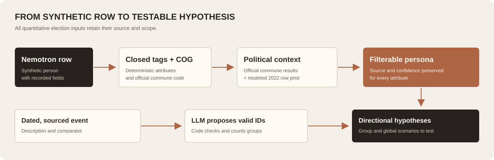
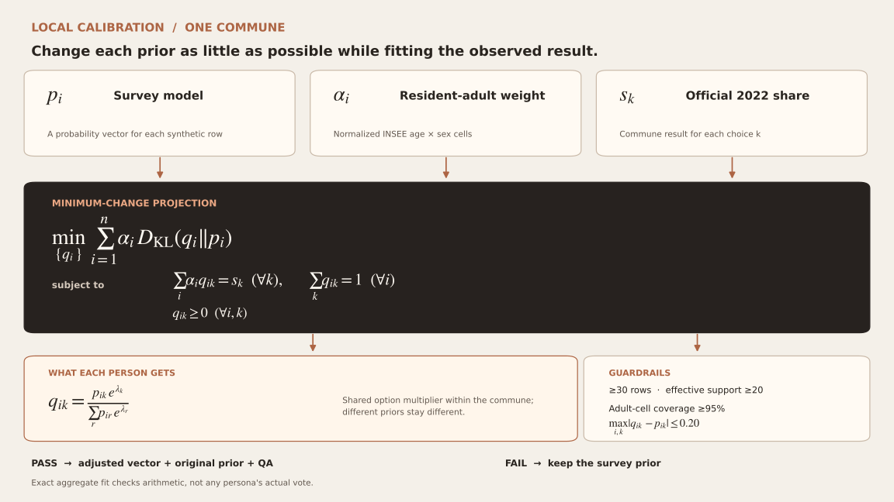

# Radar 2027: how the subpopulation feature works

Updated 16 October 2026. This is the short, readable account of the **working hypothesis explorer**. Start with the [Radar README](./README.md) for current status and navigation. There is also an [interactive HTML presentation](./presentation.html). The [pipeline reference](./pipeline.md) has import commands and detailed QA. The [Next.js Radar app](../../src/app/radar/page.tsx) now includes the original HTML prototype's overview and scenario views, with the live subpopulation workflow in its middle view.

> **What the feature can say:** “These are plausible groups to study, and these are directional reactions to test.” It cannot yet say how many French voters changed their vote because of an event.

## At a glance



1. **Describe people.** Each synthetic Nemotron row gets a closed set of demographic and geographic tags.
2. **Add political context.** Official election results describe each row's *commune*. A human survey gives each row a *modeled 2022 probability vector*.
3. **Align supported communes.** Where the synthetic frame is dense enough, a small mathematical adjustment makes its weighted average match the official 2022 result while keeping between-person differences.
4. **Analyze an event.** An LLM proposes affected groups using valid tags; code checks the filters. Another LLM suggests directional responses for a few matched personas and counterfactuals to measure.

The standalone HTML prototype displayed fixed percentage shifts. The Next.js subpopulation view uses the live path above and labels its output **hypothesis**. The overview chart, news, and scenario votes remain clearly marked local simulations.

## 1. The persona frame

We scanned all 12 Parquet shards of [NVIDIA Nemotron-Personas-France](https://huggingface.co/datasets/nvidia/Nemotron-Personas-France) at revision `ca99b66bb9cd7bc5dc6e5bef0f77ed7bfc443715`. We selected **whole communes**, keeping every Nemotron row in each chosen place. The current frame holds **115,011 rows in 162 nonempty communes**: 71 midsize places chosen across region × density strata, 96 selected small places (88 with rows), and Paris, Lyon, Marseille and their arrondissements. It covers 12 non-Corsican metropolitan regions. A separate **2,000-row distributed discovery frame** keeps global scenario examples fast.

This is a deliberately clustered *synthetic* frame. Neither its raw row counts nor its tag frequencies estimate the French population. A local group outside the selected communes cannot yet be evaluated on this frame.

### Closed tags

The ontology permits **51 tag IDs** covering age, sex, education, broad occupation, household, marital status, density, commune size, the Paris/Lyon/Marseille municipal system, and explicit current or former professions. Direct fields and deterministic groupings can be used immediately. A profession found in a synthetic biography carries its evidence phrase but **requires review** before filtering; the selected frame has 3,281 such *candidate assignments*, not approved facts. Unknown values stay unknown. For example, “retired professors in the countryside” needs separate retired, approved former-professor, and rural tags; a broad executive label cannot stand in for *profession libérale*.

```text
for each Nemotron row:
    resolve (commune name, department) to an INSEE COG code
    add direct tags from recorded fields
    derive age, occupation, household, and geographic tags by fixed rules
    record explicit biography phrases as review-only candidate tags
    leave missing or ambiguous attributes unknown
```

## 2. Which election data did we add?

| Source | Added to a row | Meaning |
| --- | --- | --- |
| [Harmonized official results](https://www.data.gouv.fr/datasets/donnees-des-elections-agregees) | Commune tallies for **2022 presidential T1, 2024 European T1, 2024 legislative T1, and 2026 municipal T1** | Observed *place* context, never the row's personal vote. All 115,011 selected rows matched all four joins. |
| [Voter Autrement 2022 respondents](https://zenodo.org/records/18848264) and official national 2022 totals | A **modeled 2022 presidential probability vector per row**, including abstention and blank/null | A weak historical survey prior, not an observed ballot or current 2027 intention. |
| [INSEE COG](https://www.insee.fr/fr/information/8740222), [density grid](https://www.insee.fr/fr/information/8571524), [RP 2022 POP1A](https://www.insee.fr/fr/statistiques/8581810?sommaire=8581933) | Commune codes, geography tags, and resident-adult age × sex population weights | Filtering and poststratification inputs. Adult residents are not identical to registered voters. |

The election importer checks polling-station ballot arithmetic and aggregates to commune. Nemotron has no voter address, so attaching a polling station would invent precision. Municipal candidate/list labels remain local; we have not guessed a national party label for every list.

For the 2022 row prior, a regularized multinomial model learned from **2,032 usable stated intentions** in a downloaded 2,122-row survey file. It used age, sex, broad occupation, and region; **508 respondents were held out**. Held-out multiclass log loss was **2.175**, versus **2.201** for predicting survey prevalence alone: a small improvement. Its national intercepts were then adjusted to official metropolitan shares **on the human survey frame**, before scoring Nemotron rows. The survey's published participant count differs from the downloaded file count and still needs reconciliation.

There are **no persona-level 2024 European, legislative, or municipal vote vectors** yet. Those elections currently supply real commune context only. Aggregate election returns cannot reveal how a synthetic individual voted.

## 3. How the local adjustment works



Let `pᵢ` be persona `i`'s survey-based vector, `qᵢ` its adjusted vector, `αᵢ` its normalized resident-adult weight, and `s` the observed 2022 commune outcome shares. We choose the **smallest weighted KL change** satisfying the commune average:

$$
\begin{aligned}
\underset{\{q_i\}}{\operatorname{minimize}}\quad
& \sum_{i=1}^{n} \alpha_i D_{\mathrm{KL}}(q_i\Vert p_i) \\
\text{subject to}\quad
& \sum_i \alpha_i q_{ik}=s_k \quad (\forall k), \\
& \sum_k q_{ik}=1 \quad (\forall i), \qquad q_{ik}\geq 0 \quad (\forall i,k).
\end{aligned}
$$

The solution applies one option-odds multiplier within each commune, then renormalizes each row. People with different starting priors keep different *pairwise log odds*; they do not all become the commune average. This preserves existing diversity but cannot create justified diversity if the survey model supplied none.

$$
q_{ik}=\frac{p_{ik}e^{\lambda_k}}{\sum_r p_{ir}e^{\lambda_r}}
$$

```text
for each selected commune:
    if rows < 30 or effective support < 20: keep survey prior
    if age × sex adult-population coverage < 95%: keep survey prior
    solve the minimum-KL projection to the official 2022 shares
    if any row-option probability moves by > 0.20: keep survey prior
    else store adjusted vectors, original vectors, and QA provenance
```

**Result:** 73 communes and **113,975 rows** passed. The largest official-share residual was `9.1×10⁻⁹`; the largest accepted row-option change was **0.175**, and minimum effective support was **47.6**. The other **1,036 rows** keep the survey prior, mostly in very small communes; one midsize commune failed the shift guardrail. An exact aggregate match checks the calculation, **not** the correctness of any personal prediction. Matching registered-voter outcome shares with resident-adult synthetic weights is a modeling convention, not a measured electorate distribution.

## 4. From an event to testable groups

```text
input: dated event description + source URL
LLM: propose 2–4 affected groups, valid tag IDs, mechanisms, and counterfactuals
code: validate tag enum and all/any/none filters; resolve named places via INSEE
code: count matches, flag missing membership attributes and sparse groups
LLM: for up to six matched personas, compare event with its stated alternative
output: direction toward/away/no-clear-change by bloc and abstention
```

The LLM is given only allowable tag IDs, so invented tags fail validation. The code performs filtering; the LLM does not decide membership. Global scenarios use the separate distributed discovery frame. Both group and global responses are **conditional-on-exposure hypotheses** over a few synthetic personas, with no probability-point effect, national vote share, or causal estimate. A 2027 row baseline is unnecessary for this *relative* question; absolute 2027 forecasts would require one.

## What remains before stronger claims

1. **Independent human checks for the 2022 prior.** Validate subgroup and held-out-place predictions, reconcile the survey count discrepancy, and handle historic commune boundaries.
2. **Appropriate 2024 respondent microdata.** [CEVIPOF ENEF 2024](https://data.sciencespo.fr/dataverse/ENEF2024) documents useful vote, demographic, and wave variables, but its respondent CSV/ZIP downloads returned HTTP 403 under secondary-use restrictions. The user cannot access them now. The public [Voter Autrement 2024](https://zenodo.org/records/13898654) experiment is self-selected and too limited demographically to replace this evidence.
3. **Human review and geographic expansion.** Audit fine profession tags on held-out biographies. Add an on-demand or broader frame for places outside the current selection, including Corsica; pool sparse cells only where justified.
4. **French event-response validation.** Measure exposure and pre/post intention on humans, including null and negative contrasts, before publishing numerical effects. In an adjacent US randomized persuasion sanity check, the current directional prompt was correct on only **3 of 7** conclusive contrasts.
5. **Deployment data.** The calibrated selected-commune index is **1.89 GB** and git-ignored. A new environment must build or receive the versioned index and the global discovery index before live routes work.

**Current release boundary:** the integrated Next.js app is a working, traceable **hypothesis explorer**. Its illustrative polling and scenario content must stay labeled as demo data; its live subpopulation output must stay labeled as unvalidated until the human evidence above exists.
